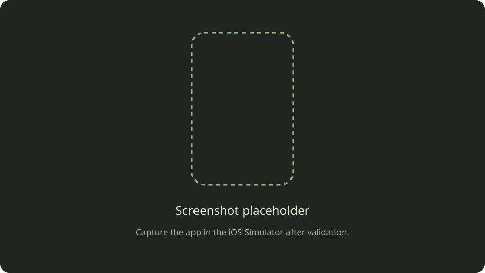

# Checkout Engine

Introduce PaymentProcessing, inject processors and mocks, then report lifecycle events through a weak delegate.

## Choose a starting point

- [Starter project](Projects/starter/): Concrete credit-card dependency; follow the Protocols milestones.
- [Final project](Projects/final/): completed reference implementation.
- [Download starter](../downloads/04-protocols-practice-starter.zip)
- [Download final](../downloads/04-protocols-practice-final.zip)

Open `CheckoutEngine/CheckoutEngine.xcodeproj` inside either folder. Use Xcode 27 or later with the iOS SDK installed; the app targets iOS 17.6+. Choose an iPhone Simulator and run. A simulator does not require a development team. For a physical device, select your own team and bundle identifier.

These are local simulations. They do not contact a payment provider or charge money. The examples preserve the lesson’s Double amounts to focus on protocols and generics; they are not a production money model.

## Verify your work

Follow the lesson’s eight milestones: concrete dependency, second processor, contract, substitution, injection, mock tests, delegation, and weak ownership.

The reference UI adds ObservableObject/@Published so lifecycle updates appear in SwiftUI and prevents duplicate button taps while processing.

In `Projects/final`, run `swift test` on macOS. The package tests compile the same core source files used by the Xcode app. Tests cover forwarded amounts, success/failure status, ordered delegate events, weak ownership, and invalid payment amounts.  The Xcode project is the app target; automated core tests are in the adjacent Swift package, not a placeholder Xcode test target.

## Visual walkthrough

<!-- SCREENSHOT TODO: Capture CheckoutView on an iPhone Simulator in Ready state. Use an uncluttered device frame and retain the $100.00 amount. -->

<!-- SCREENSHOT TODO: Replace with a second image after a successful payment showing Payment completed. For Generics, explain that the UI is intentionally unchanged; show PaymentService and the passing test suite in the walkthrough instead of implying new UI. -->
> Screenshot pending: successful payment state and passing reference tests.

## Compare thoughtfully

Implement your own solution before opening final. Compare responsibilities, not just filenames. Changing the injected processor should not require changing checkout orchestration; failure should still reach the view model; releasing the delegate should not retain it.
